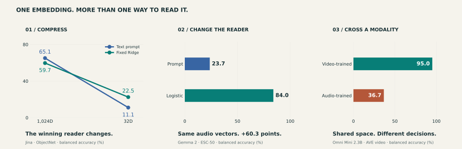
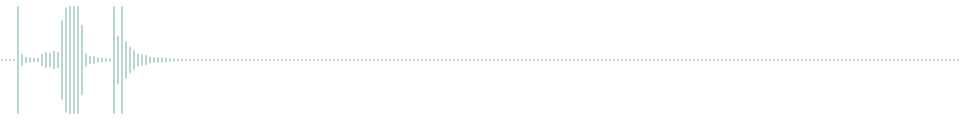

<div align="center">

# RECAP

### A Shared Embedding Space Is Not a Shared Decision Space

**Frozen vectors. Different readers. Different decisions.**

[Listen & explore](demo/README.md) · [Quickstart](#quickstart) · [Reproduce the paper](docs/reproduce.md) · [Data & splits](splits/README.md) · [Browse the code](#find-your-way)

</div>

[](demo/README.md)

An embedding benchmark tells you how a particular reader performs. RECAP asks what changes when you compress the vector, train the reader in another modality, or fit it on task labels. We keep the encoders frozen and evaluate the reader on the same held-out inputs.

## Hear it before reading the scores

**One five-second sound.** Four checkpoints' selected text prompts predict *clapping*, *sneezing*, *glass breaking*, and *crackling fire*. Their learned readers all recover the dataset label from the same stored vectors.

[](demo/README.md)

The [interactive companion](demo/README.md) lets you listen before revealing the answer, switch between audio-trained and video-trained readers on a fixed input, and watch compression reverse a reader recommendation. It also includes an image rescue **and a regression**.

```bash
python -m http.server 8000 --bind 127.0.0.1
# Open http://localhost:8000/demo/
```

No installation, GPU, model download, or network connection is needed to use the demo. The media and saved predictions are bundled; the page runs locally. Examples are deliberately outcome-selected illustrations. Aggregate claims come from complete evaluation sets.

## Quickstart

Python 3.10–3.12. Rebuild the numerical paper figures on CPU:

```bash
uv sync
uv run python scripts/make_figures.py --output outputs/paper
uv run python -m unittest discover -s tests -v
```

This regenerates the five quantitative figures and nine LaTeX tables from the bundled measured outputs. [Installation with pip, feature extraction, and complete experiment commands →](docs/reproduce.md)

## Three questions about a frozen vector

| Question | What RECAP holds fixed | Start here |
| --- | --- | --- |
| **Does the reader ranking survive compression?** | Inputs, labels, and folds; refit Ridge at each supported width | [Axis 1](docs/reproduce.md#axis-1-compression-ranking-stability) · [code](recap/protocols/compression.py) |
| **Does the reader transfer across modalities?** | The target vectors; compare target-trained and cross-trained readers | [Axis 2](docs/reproduce.md#axis-2-cross-modal-ave-transfer) · [code](recap/protocols/transfer.py) |
| **What labels are linearly recoverable?** | Encoder, modality, width, and held-out folds | [Axis 3](docs/reproduce.md#axis-3-nested-label-recoverability) · [code](recap/protocols/recoverability.py) |
| **Which system fits a storage and label budget?** | Identical capped support for native and joint selection | [Joint selection](docs/reproduce.md#joint-selection-under-resource-constraints) · [code](recap/protocols/selection.py) |

The panel covers seven released checkpoints across five families. Natural recognition uses source-grouped nested cross-validation; AVE uses the source-disjoint official train/test split. CLEVR and CATER provide controlled checks. All widths stay within each checkpoint's documented support.

## Find your way

| If you want to… | Open |
| --- | --- |
| Listen, watch, and inspect individual reader disagreements | [Media companion](demo/README.md) |
| Install dependencies or rerun a paper experiment | [Reproduction guide](docs/reproduce.md) |
| Find checkpoint IDs, revisions, and supported widths | [Checkpoint registry](configs/models.json) |
| Obtain media and understand the exact input sets | [Data & split guide](splits/README.md) |
| Extract and cache frozen vectors | [Extraction CLI](scripts/extract_embeddings.py) · [model interfaces](recap/models.py) |
| Inspect fitting, prompt selection, or metrics | [Readers](recap/readers.py) · [metrics](recap/metrics.py) |
| Rebuild a table or figure from evaluation outputs | [Figure script](scripts/make_figures.py) · [recorded numerical outputs](paper_results/results.json) |

<details>
<summary><strong>A few boundaries worth keeping in view</strong></summary>

- These are diagnostics of label accessibility under specified readers, not measurements of information-theoretic capacity.
- The demo displays saved held-out decisions. It performs no live inference, and its selected examples are not estimates of success rates.
- The recorded joint-selection search uses the exact candidate widths in [its config](configs/selection.json), which are narrower than the full supported-width registry.
- Encoder reruns need the pinned checkpoints and benchmark media. The CPU tests exercise the protocols; they do not run the seven encoders.

</details>
